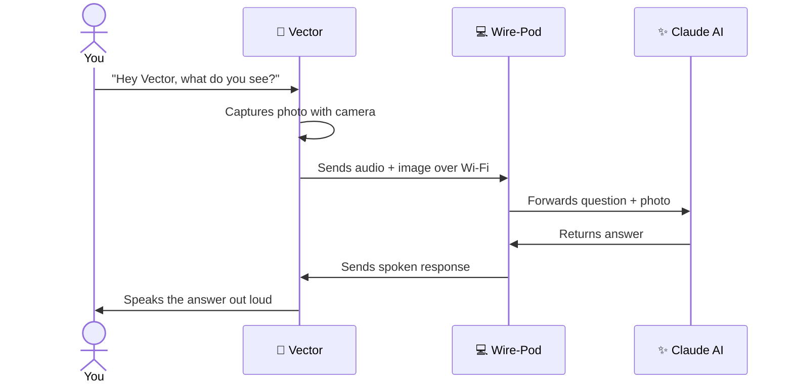

# Getting to Know Vector

---

## What is Vector?

Vector is a small home robot made by a company called **Anki**. He lives on a desk or table, reacts to voices and faces, answers questions, plays games, and roams around on his own.

Vector has a tiny camera, a speaker, four wheels, a lift arm, and an expressive screen that serves as his face. He recognizes the people around him, notices when you pick him up or pet him, and generally behaves like a small curious creature rather than a gadget waiting for commands.

Anki designed Vector to be genuinely autonomous — he has moods, gets bored, explores on his own initiative, and reacts to his environment without being asked.

---

## What Happened to Anki?

**Anki shut down in April 2019.** The company ran out of funding and closed without warning, leaving Vector owners with a robot that depended on Anki's cloud servers to function.

Without those servers, Vector couldn't process voice commands, answer questions, or do much of anything.

The robotics community refused to let that be the end of the story.

---

## Wire-Pod: Keeping Vector Alive

An open-source project called **Wire-Pod** recreates Anki's cloud server locally. Running on a nearby computer, Wire-Pod gives Vector everything he needs:

- Speech recognition (he can hear you again)
- Voice command processing
- Answers to questions
- Customization options that Anki never offered

Vector connects to Wire-Pod over Wi-Fi, just like he used to connect to Anki's servers — he doesn't know the difference.

---

## Claude AI Inside

This Vector has been further customized to run on **Claude**, Anthropic's AI. Instead of a generic chatbot, Vector uses Claude claude-opus-4-6 — Anthropic's most capable model — to understand questions, describe what he sees, and carry on conversations.

When you ask Vector a question, he captures a photo with his camera, sends it to Claude along with what he heard, and speaks the response back to you. The answer is informed by what's actually in front of him.

The customization was built by Michael leveraging Claude Code, Anthropic's AI coding agent, which wrote and modified most of the software that connects Vector's voice commands to Claude's responses.

---

## Things to Try

Wake Vector up by saying **"Hey Vector"** and waiting for the double beep and blue light. Then speak your command.

### Classic Commands

| Say this | What Vector does |
|---|---|
| "Hey Vector, what time is it?" | Tells you the current time |
| "Hey Vector, set a timer for 2 minutes" | Sets a countdown timer |
| "Hey Vector, fist bump" | Holds up his lift arm for a fist bump |
| "Hey Vector, do a trick" | Performs a random trick |
| "Hey Vector, go to sleep" | Powers down into sleep mode |
| "Hey Vector, volume up" | Raises his speaker volume |

### Ask Him Anything

Say **"Hey Vector, I have a question"** — he'll get ready to listen. Then ask him anything:

- "What is the speed of light?"
- "Who wrote Frankenstein?"
- "What's the capital of Brazil?"

He processes the question using Claude and speaks the answer back.

### Look Around

Say **"Hey Vector, what do you see?"** or **"Hey Vector, look around"**

Vector captures a photo with his camera and describes what he sees in front of him, using Claude's vision to interpret the image.

### Explore the Room

Say **"Hey Vector, explore the house"** or **"Hey Vector, take a walk"**

Vector drives around on his own for several minutes, narrating his observations as he goes. He uses his camera and Claude to describe what he encounters. When he's done, he returns to his charger.

### Tell Him Your Name

Say **"Hey Vector, my name is [your name]"**

He'll remember you. If he sees your face during an exploration, he'll greet you by name.

---

* Idea by Michael · Vector hardware by Anki · Wire-Pod by the open-source community · AI by Anthropic Claude*
